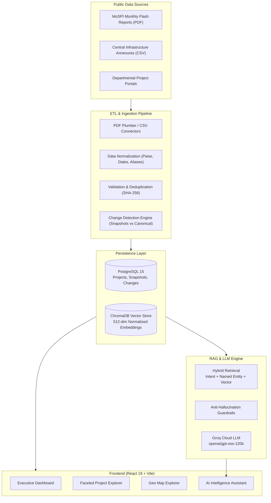
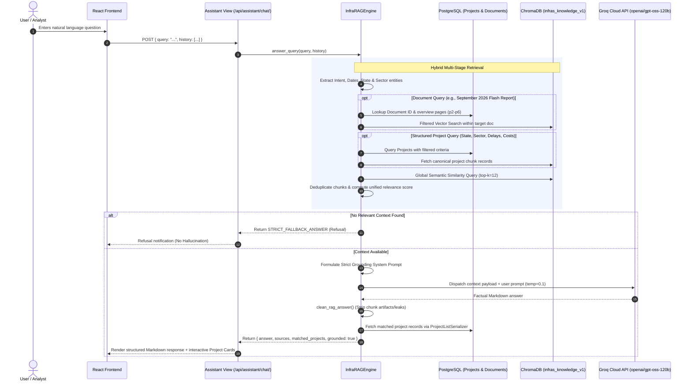
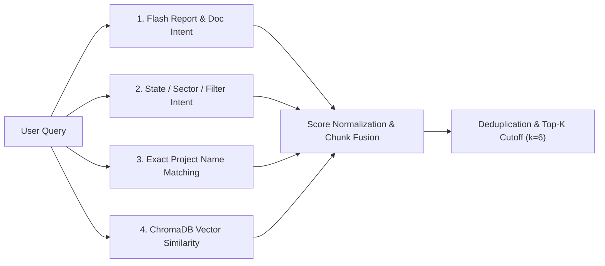
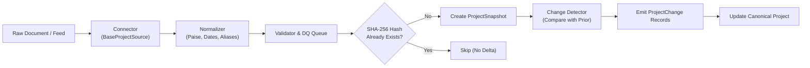

# InfraIndia — Infrastructure Intelligence Platform

<p align="center">
  
</p>

<p align="center">
  <strong>Comprehensive Central Sector Infrastructure Monitoring, Historical Change Tracking & Grounded AI Intelligence for India</strong>
</p>

<p align="center">
  
  
  
  
  
  
  
  
</p>

---

## Table of Contents
- [1. Executive Summary](#1-executive-summary)
- [2. Platform Architecture & Data Flow](#2-platform-architecture--data-flow)
- [3. Deep Dive: AI Assistant & Grounded RAG Architecture](#3-deep-dive-ai-assistant--grounded-rag-architecture)
  - [3.1 RAG Architecture Overview](#31-rag-architecture-overview)
  - [3.2 Multi-Modal Knowledge Ingestion Pipeline](#32-multi-modal-knowledge-ingestion-pipeline)
  - [3.3 Chunking Strategy & Document Decomposition](#33-chunking-strategy--document-decomposition)
  - [3.4 High-Performance Embedding Vectorizer](#34-high-performance-embedding-vectorizer)
  - [3.5 Persistent Vector Storage (ChromaDB)](#35-persistent-vector-storage-chromadb)
  - [3.6 Multi-Stage Hybrid Retrieval Engine](#36-multi-stage-hybrid-retrieval-engine)
  - [3.7 Strict Anti-Hallucination Guardrails & Refusal Protocol](#37-strict-anti-hallucination-guardrails--refusal-protocol)
  - [3.8 LLM Synthesis with Groq Cloud](#38-llm-synthesis-with-groq-cloud)
  - [3.9 Post-Processing, Clean Output & Entity Linking](#39-post-processing-clean-output--entity-linking)
  - [3.10 Vector Index Management CLI](#310-vector-index-management-cli)
- [4. Core Platform Capabilities](#4-core-platform-capabilities)
  - [4.1 Dashboard & Central KPI Metrics](#41-dashboard--central-kpi-metrics)
  - [4.2 Project Explorer & Faceted Search](#42-project-explorer--faceted-search)
  - [4.3 Historical Snapshots & Change Detection Engine](#43-historical-snapshots--change-detection-engine)
  - [4.4 Geographic Map Explorer](#44-geographic-map-explorer)
  - [4.5 Cross-Project Comparison Tool](#45-cross-project-comparison-tool)
  - [4.6 Advanced Macro Analytics](#46-advanced-macro-analytics)
- [5. Data Ingestion & ETL Pipeline](#5-data-ingestion--etl-pipeline)
- [6. Technology Stack](#6-technology-stack)
- [7. Directory Structure](#7-directory-structure)
- [8. REST API Reference](#8-rest-api-reference)
- [9. Installation & Deployment](#9-installation--deployment)
  - [9.1 Docker Compose (Recommended)](#91-docker-compose-recommended)
  - [9.2 Manual Local Development Setup](#92-manual-local-development-setup)
- [10. Environment Configuration](#10-environment-configuration)
- [11. Legal & Data Disclaimer](#11-legal--data-disclaimer)

---

## 1. Executive Summary

**InfraIndia** is an enterprise-grade government infrastructure intelligence platform designed to ingest, normalize, track, compare, and reason over publicly available central sector infrastructure projects across India.

Monitoring national infrastructure at scale is historically plagued by fragmentation: project data is distributed across diverse government ministries, monthly flash reports (MoSPI), PDFs, annexures, spreadsheets, and departmental dashboards. **InfraIndia** unifies this disparate landscape into:
1. **A Canonical Relational Database** with rigorous currency normalization (stored in integer paise to eliminate floating-point drift) and temporal tracking.
2. **An Automated Change Detection Engine** that generates immutable point-in-time snapshots and registers discrete change events (cost escalations, milestone slippages, expenditure updates).
3. **A Strictly Grounded Retrieval-Augmented Generation (RAG) AI Assistant** capable of answering intricate natural-language inquiries based exclusively on official verified documents without hallucinating.

> [!NOTE]
> **Independent Public Technology Platform**: InfraIndia is an independent analytics platform developed using publicly accessible records and open government datasets. It is not an official portal of the Government of India.

---

## 2. Platform Architecture & Data Flow



---

## 3. Deep Dive: AI Assistant & Grounded RAG Architecture

The **AI Intelligence Assistant** in InfraIndia is powered by a custom-engineered, multi-tier Retrieval-Augmented Generation (RAG) framework implemented in [`backend/apps/assistant/rag_engine.py`](file:///backend/apps/assistant/rag_engine.py).

Unlike generic conversational bots that hallucinate plausible answers or rely on outdated pre-trained weights, InfraIndia's RAG system enforces **absolute grounding**, delivering verifiable answers backed by exact figures from official MoSPI Flash Reports and central sector registry records.



### 3.1 RAG Architecture Overview

The system bridges unstructured documents (hundred-page PDFs) and structured relational data (project cost tables) into a unified vector space:
1. **Document Ingestion**: Continuous ingestion of PDF Flash Reports and CSV tables.
2. **Entity Chunking**: Structured synthesis of database records into natural-language narrative chunks.
3. **L2-Normalized Hashing Embeddings**: Fast, deterministic, dependency-resilient vectorization.
4. **Hybrid Retrieval**: Intent analysis + relational database filtering + semantic vector similarity.
5. **Prompt-Level Isolation**: Complete prohibition of external knowledge extrapolation.
6. **Live Data Linking**: Matched projects returned alongside generated text as interactive UI cards.

---

### 3.2 Multi-Modal Knowledge Ingestion Pipeline

The knowledge base (`infras_knowledge_v1`) combines two primary data channels:

#### A. Official PDF Flash Reports (`parse_pdf_document`)
- Extracted using `pdfplumber` page by page.
- Captures document title, exact publication month, and physical page numbers.
- Handles tabular summaries, sector aggregates, and executive overviews.

#### B. Canonical Database Project Records (`parse_project_records`)
Every central sector project stored in PostgreSQL is converted into a rich, searchable factual text chunk:
```text
Project Record #104: Jamrani Dam Multipurpose Project
External Identifier: MOSPI-ID-1482
Sector: Water Resources | Ministry: Ministry of Jal Shakti | Agency: Irrigation Department
Location: State of Uttarakhand, District: Nainital
Financials: Original Cost: ₹2,584.10 Cr | Current Revised Cost: ₹3,784.80 Cr | Cumulative Expenditure: ₹1,120.40 Cr
Cost Overrun: +46.46%
Timeline: Start Date: 2019-06-15 | Original Completion: 2024-03-31 | Current Anticipated Completion: 2027-12-31
Schedule Delay: 45 months | Physical Progress: 38.50% | Status: ACTIVE (Under Execution)
Contractor / Implementing Partner: Joint Venture Consortium
```
This guarantees that **live relational updates in PostgreSQL immediately reflect in the AI knowledge base upon indexing**.

---

### 3.3 Chunking Strategy & Document Decomposition

To preserve semantic integrity without fragmenting tables or sentences:
- **Splitter**: `RecursiveCharacterTextSplitter` from LangChain (with native fallback).
- **Chunk Size**: `1,000` characters.
- **Chunk Overlap**: `150` characters.
- **Boundary Separators**: `["\n\n", "\n", ". ", " ", ""]` to prevent cutting numbers, project identifiers, or financial metrics mid-sentence.
- **Metadata Tagging**: Each chunk is tagged with `source_type` (`document_pdf`, `document_csv`, `project_record`), `doc_id`, `doc_title`, `page`, and `chunk_idx`.

---

### 3.4 High-Performance Embedding Vectorizer

InfraIndia implements a zero-overhead, ultra-reliable L2-normalized vectorizer: `FastHashingEmbeddingFunction`.

```python
class FastHashingEmbeddingFunction(EmbeddingFunction):
    """
    Ultra-reliable, high-performance L2-normalized hashing vectorizer for ChromaDB.
    Uses sklearn HashingVectorizer with zero-dependency pure-Python fallback.
    """
    def __init__(self, n_features: int = 512):
        self.n_features = n_features
        # Unigram + Bigram tokenization with L2 normalization
```
- **Dimensionality**: 512 features.
- **N-gram Range**: (1, 2) unigrams and bigrams, capturing compound infrastructure phrases such as `"Ring Road"`, `"Cost Overrun"`, and `"Flash Report"`.
- **Normalization**: Euclidean $L_2$ norm ($\|v\|_2 = 1.0$), transforming Euclidean distance directly into cosine similarity.
- **Portability**: Does not depend on heavy neural download weights (PyTorch/Transformers), enabling instant cold starts in micro-containers.

---

### 3.5 Persistent Vector Storage (ChromaDB)

- **Engine**: ChromaDB `PersistentClient`.
- **Storage Location**: `backend/data/chroma_db/`.
- **Collection Name**: `infras_knowledge_v1`.
- **Batch Processing**: Ingestion writes occur in batches of 100 chunks using Chroma's `upsert` API to guarantee idempotency.

---

### 3.6 Multi-Stage Hybrid Retrieval Engine

When a query arrives, pure cosine similarity alone is insufficient for analytical queries (e.g. *"Show road projects delayed over 50 months"* or *"Summarize the September 2026 report"*). InfraIndia employs a 4-tier hybrid pipeline:



1. **Document & Flash Report Intent**:
   - Detects queries targeting specific publication cycles (e.g., September, July, August, June).
   - Automatically prioritizes executive summary pages (pages 2, 3, 4, 5, 6) where macro indicators are documented.
2. **State & Sector Intent**:
   - Maps 28 States and 8 Union Territories against query tokens.
   - Recognizes sector synonyms (`road`, `rail`, `power`, `metro`, `aviation`, `port`, `telecom`, `coal`, `water`).
   - Filters projects with schedule delay $>50$ months or costs $> ₹1,000 \text{ Cr}$.
3. **Exact Entity Recognition**:
   - N-gram sliding window extracts project title candidates and executes rapid indexed lookups on PostgreSQL.
4. **Dense Vector Search**:
   - Queries ChromaDB with normalized embeddings to capture nuanced semantic phrasing.
5. **Unified Scored Deduplication**:
   - Scores from all 4 channels are normalized, merged, and sorted descending. The top 6 highest-scoring chunks form the final context prompt.

---

### 3.7 Strict Anti-Hallucination Guardrails & Refusal Protocol

To maintain absolute credibility for official infrastructure figures, the RAG engine implements strict anti-hallucination protocols:

#### The Refusal Contract
If a user asks about unverified external matters (e.g., sports, general world knowledge, personal opinions, unrecorded projects), the system is strictly instructed **never** to speculate. It triggers the uniform refusal response:

```text
"I do not have sufficient information in the ingested InfraIndia documents and records to answer this question. Please ask a question related to tracked central sector infrastructure projects, MoSPI flash reports, or platform datasets."
```

#### System Grounding Directives
The system prompt establishes explicit constraints:
1. **Context Boundary**: Must answer exclusively and solely based on the provided context records.
2. **No Extrapolation**: Zero tolerance for inventing completion dates, contractors, or expenditure metrics.
3. **No Formatting Leaks**: Prohibits raw chunk annotations (e.g. `*Source: Project: Jamrani Dam, Page 1*`) from leaking into prose.

---

### 3.8 LLM Synthesis with Groq Cloud

- **Primary Model**: `openai/gpt-oss-120b` running on Groq LPU (Language Processing Unit) hardware for ultra-low latency inference (~300–800ms).
- **Fallback Model**: `qwen/qwen3.8-27b` automatically engaged if the primary reasoning model experiences upstream rate limiting.
- **Inference Temperature**: Set to `0.1` to maximize deterministic factual accuracy and minimize creative drift.
- **Context Window**: Compact, highly relevant context payloads with last 2 conversational turns included for continuity.

---

### 3.9 Post-Processing, Clean Output & Entity Linking

Once the LLM generates a response:
1. **Regex Cleaning (`clean_rag_answer`)**: Eliminates trailing chunk identifiers, accidental system prompt echoes, or citation footnotes.
2. **Entity Correlation**:
   - Any project referenced in the retrieved chunks or answer is looked up in PostgreSQL.
   - Serialized via `ProjectListSerializer`.
   - Rendered directly below the AI response as interactive cards containing cost, progress, delay, and direct deep-links.

---

### 3.10 Vector Index Management CLI

The RAG index can be managed via Django's management interface:

```bash
# Index with default parameters (up to 40 PDF pages per document)
docker compose exec backend python manage.py index_rag

# Force rebuild the ChromaDB collection from scratch
docker compose exec backend python manage.py index_rag --force

# Custom page limit for comprehensive deep parsing
docker compose exec backend python manage.py index_rag --limit-pages 100 --force
```

---

## 4. Core Platform Capabilities

### 4.1 Dashboard & Central KPI Metrics
- **Aggregate Metrics**: Total monitored valuation (in ₹ Lakh Crore), active vs completed counts, delayed projects ratio.
- **Sector Valuation Breakdown**: Interactive donut charts and progress distributions.
- **Recent Ingestion Activity**: Status cards tracking newly processed source files and change events.

### 4.2 Project Explorer & Faceted Search
- **Multi-Faceted Filtering**: Filter by State, Sector, Ministry, Platform Status, and Cost Overrun range.
- **Full-Text Instant Search**: Modal search palette accessible via `Ctrl + K` across the entire app.
- **Sortable Columns**: Sort by Revised Cost, Schedule Delay, Progress %, and Last Updated Date.

### 4.3 Historical Snapshots & Change Detection Engine
- **Immutable Snapshots**: Every sync creates a `ProjectSnapshot` without modifying previous history.
- **Delta Tracking**: Detects exact field changes between snapshots:
  - `COST_CHANGED`: Tracks absolute ₹ amount and percentage cost escalations.
  - `COMPLETION_DATE_CHANGED`: Calculates schedule slippage in calendar months.
  - `PROGRESS_CHANGED`: Tracks reported physical execution percentage.
  - `EXPENDITURE_CHANGED`: Measures cash deployment across fiscal reporting quarters.

### 4.4 Geographic Map Explorer
- **Interactive State Choropleth**: Built with `react-simple-maps` using TopoJSON boundaries.
- **State-Level Drill-Down**: Click on any state to filter projects, total capital allocation, and delayed projects.

### 4.5 Cross-Project Comparison Tool
- Compare up to 4 major infrastructure projects side-by-side across:
  - Original vs Current Cost
  - Time overruns & Completion dates
  - Progress curves & Cumulative expenditure
  - Contractor and executing agency information

### 4.6 Advanced Macro Analytics
- Interactive charts powered by `recharts`:
  - Cost vs Time Delay Correlation Matrix
  - Sector-wise Capital Outlay vs Physical Execution
  - Top 10 Most Delayed Projects Nationwide
  - Top 10 Highest Capital Allocation Mega-Projects

---

## 5. Data Ingestion & ETL Pipeline



### Key Normalization Standards
- **Monetary Storage**: Stored exclusively as integer `paise` in `BigIntegerField` ($1 \text{ Crore} = 10,000,000 \text{ paise} = 10^7 \text{ paise}$).
- **Dates**: Standardized to ISO-8601 (`YYYY-MM-DD`).
- **State Names**: Aliases like `"UP"`, `"U.P."`, `"Uttar Pradesh State"` mapped to canonical `"Uttar Pradesh"`.

---

## 6. Technology Stack

### Backend
| Technology | Version / Spec | Purpose |
|---|---|---|
| **Python** | 3.11+ | Backend runtime environment |
| **Django & DRF** | 4.2 LTS / 3.14 | Web framework & REST API layer |
| **PostgreSQL** | 15 Alpine | Relational storage for projects, snapshots & changes |
| **ChromaDB** | 0.4.22+ | Persistent vector database for RAG embeddings |
| **Groq SDK** | 0.11.0+ | LLM inference client (`openai/gpt-oss-120b`) |
| **pdfplumber** | 0.11+ | High-fidelity PDF text and table extraction |
| **Scikit-Learn** | 1.3.0+ | Fast hashing vectorizer & L2 normalization |
| **LangChain Text Splitters**| 0.0.1+ | Recursive character text chunking |
| **Gunicorn** | 21.2 | WSGI HTTP production server |

### Frontend
| Technology | Version / Spec | Purpose |
|---|---|---|
| **React** | 19.2 | Modern UI library with Concurrent Mode |
| **Vite** | 8.3 | Build tool & high-speed development server |
| **React Router** | 7.18 | Client-side routing with clean layout nested shell |
| **Recharts** | 3.10 | Responsive SVG charting for analytics |
| **React Simple Maps** | 5.0 | GeoJSON/TopoJSON map visualizations for India |
| **Lucide React** | 1.46 | Consistent, modern icon system |
| **Axios** | 1.20 | REST API client with interceptors |

---

## 7. Directory Structure

```text
InfraIndia/
├── backend/
│   ├── apps/
│   │   ├── accounts/          # User authentication and profile models
│   │   ├── alerts/            # Automated threshold alerts (cost & delay spikes)
│   │   ├── analytics/         # Macro aggregation views and stats endpoints
│   │   ├── assistant/         # Grounded RAG engine, ChromaDB client & chat API
│   │   │   ├── management/    # CLI command: index_rag
│   │   │   ├── rag_engine.py  # Hybrid retrieval, prompt templates & Groq integration
│   │   │   ├── views.py       # Chat, status, and reindexing API views
│   │   │   └── urls.py        # Assistant routes
│   │   ├── documents/         # Uploaded PDF flash reports, CSVs & metadata
│   │   ├── ingestion/         # Ingestion run tracking, logs & data quality queue
│   │   ├── locations/         # State, District, and geospatial coordinates
│   │   ├── organizations/     # Ministry, Department, and Agency models
│   │   ├── projects/          # Canonical Project, ProjectSnapshot, ProjectChange
│   │   └── sources/           # External DataSource registry & endpoints
│   ├── config/                # Django settings, WSGI, and global URL routing
│   ├── data/
│   │   └── chroma_db/         # Persistent ChromaDB vector database storage
│   ├── services/
│   │   ├── change_detection/  # Snapshot comparison & change event generation
│   │   ├── connectors/        # MoSPI PDF & CSV parser connectors
│   │   └── normalization/     # Currency, date, and state name normalizers
│   ├── manage.py
│   ├── requirements.txt
│   └── Dockerfile
├── frontend/
│   ├── public/
│   │   ├── favicon.svg        # Scalable SVG logo icon
│   │   ├── logo.png           # Synchronized public brand emblem
│   │   └── india_states.geojson # TopoJSON/GeoJSON map polygons
│   ├── src/
│   │   ├── assets/            # Bundled images & assets (logo.png)
│   │   ├── components/        # Reusable UI cards, tables, search palette, layout
│   │   ├── context/           # ThemeContext (Dark / Light mode state)
│   │   ├── pages/
│   │   │   ├── AIAssistant.jsx    # Conversational RAG assistant interface
│   │   │   ├── Analytics.jsx      # Macro charts & distribution trends
│   │   │   ├── Compare.jsx        # Side-by-side project comparison
│   │   │   ├── Dashboard.jsx      # Executive KPI overview
│   │   │   ├── MapExplorer.jsx    # Interactive India choropleth map
│   │   │   ├── ProjectDetails.jsx # Detailed project profile & timeline
│   │   │   ├── Projects.jsx       # Faceted project table & search
│   │   │   └── About.jsx          # Platform mission & methodology
│   │   ├── services/          # Axios API bindings
│   │   ├── App.jsx            # Layout shell, global header & route tree
│   │   ├── index.css          # Core CSS variables, typography & utility classes
│   │   └── main.jsx
│   ├── package.json
│   ├── vite.config.js
│   └── Dockerfile
├── docs/                      # Architectural specs & data source documentation
├── docker-compose.yml         # Multi-container production deployment config
└── README.md                  # Complete platform documentation
```

---

## 8. REST API Reference

| Endpoint | Method | Description |
|---|---|---|
| `/api/assistant/chat/` | `POST` | Execute grounded RAG query via Groq LLM |
| `/api/assistant/status/` | `GET` | Return ChromaDB vector index count & model info |
| `/api/assistant/reindex/` | `POST` | Trigger background re-indexing of documents & projects |
| `/api/projects/` | `GET` | List projects with filtering (state, sector, status, cost) |
| `/api/projects/{id}/` | `GET` | Retrieve full project record including timeline & financials |
| `/api/projects/{id}/snapshots/` | `GET` | Retrieve immutable historical snapshots for a project |
| `/api/projects/{id}/changes/` | `GET` | Retrieve discrete change events (cost & schedule deltas) |
| `/api/analytics/overview/` | `GET` | Macro platform statistics, total outlay & delay ratios |
| `/api/analytics/sectors/` | `GET` | Sector-wise valuation, counts, and expenditure stats |
| `/api/analytics/delays/` | `GET` | Top delayed infrastructure projects nationwide |
| `/api/locations/states/` | `GET` | List states with aggregated project metrics |
| `/api/documents/` | `GET` | List uploaded official documents & flash reports |
| `/api/sources/` | `GET` | View registered public data sources and sync status |

---

## 9. Installation & Deployment

### 9.1 Docker Compose (Recommended)

The simplest way to run the full stack (PostgreSQL, Django Backend, Nginx + React Frontend) is using Docker Compose:

1. **Clone the repository:**
   ```bash
   git clone https://github.com/your-org/InfraIndia.git
   cd InfraIndia
   ```

2. **Configure Environment Variables:**
   Create or verify `backend/.env` (see [Section 10](#10-environment-configuration)).

3. **Build and Launch Containers:**
   ```bash
   docker compose up -d --build
   ```

4. **Verify Running Services:**
   ```bash
   docker compose ps
   ```
   - **Frontend Application**: `http://localhost:80` (or `http://localhost`)
   - **Backend REST API**: `http://localhost:8000/api/`
   - **Django Admin Portal**: `http://localhost:8000/admin/`

5. **Index the AI Knowledge Base:**
   ```bash
   docker compose exec backend python manage.py index_rag
   ```

---

### 9.2 Manual Local Development Setup

#### Backend Setup
```bash
cd backend
python -m venv venv
source venv/bin/activate  # On Windows: venv\Scripts\activate
pip install -r requirements.txt

# Apply Database Migrations
python manage.py migrate

# Seed Demo Data & Sources (Optional)
python manage.py setup_sources
python manage.py seed_demo_data

# Index Documents & Projects into ChromaDB
python manage.py index_rag

# Run Development Server
python manage.py runserver 0.0.0.0:8000
```

#### Frontend Setup
```bash
cd frontend
npm install
npm run dev
```
The frontend will start at `http://localhost:5173`.

---

## 10. Environment Configuration

Create a `.env` file inside the `backend/` directory with the following variables:

```ini
# Django Core Settings
SECRET_KEY=your-secure-production-secret-key
DEBUG=False
ALLOWED_HOSTS=*
CORS_ALLOWED_ORIGINS=http://localhost,http://localhost:5173,http://localhost:80,http://127.0.0.1

# Database Configuration
DATABASE_URL=postgres://govuser:govpassword@db:5432/govproject

# AI & LLM Inference (Groq Cloud)
GROQ_API_KEY=gsk_your_groq_api_key_here
GROQ_MODEL=openai/gpt-oss-120b

# Default Superuser Credentials (auto-created on container launch)
DJANGO_SUPERUSER_USERNAME=admin
DJANGO_SUPERUSER_PASSWORD=admin
DJANGO_SUPERUSER_EMAIL=admin@example.com
```

---

## 11. Legal & Data Disclaimer

1. **Non-Affiliation**: InfraIndia is an independent technology initiative. It is not affiliated, authorized, associated, or officially endorsed by the Ministry of Statistics and Programme Implementation (MoSPI) or any Ministry/Department of the Government of India.
2. **Data Lineage**: All project information, baseline budgets, schedule revisions, and physical progress metrics are retrieved from publicly released government publications, flash reports, and permitted open datasets.
3. **Accuracy**: While every effort is made through automated normalization, deduplication, and strict anti-hallucination guardrails to ensure fidelity to official reports, users should refer to primary official gazettes and ministry portals for statutory or financial decision-making.

---

<p align="center">
  <strong>InfraIndia</strong> — Transforming fragmented public infrastructure data into verifiable project intelligence.
</p>

